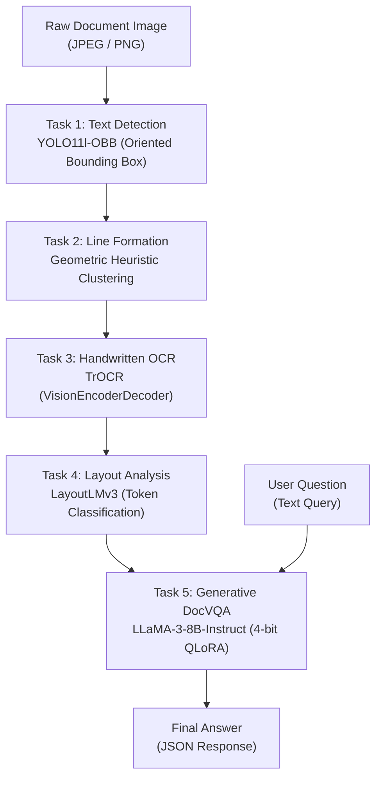

# 🖋️ End-to-End Handwritten Document AI & VQA System (DocVQA)

[](https://www.python.org/)
[](https://pytorch.org/)
[](https://github.com/ultralytics/ultralytics)
[](https://huggingface.co/)
[-blueviolet.svg)](https://github.com/unslothai/unsloth)
[](https://fastapi.tiangolo.com/)

---

## 📖 Tổng quan dự án (Executive Summary)

Dự án này là hệ thống **Document AI & Visual Question Answering (DocVQA)** toàn diện, chuyên sâu cho tài liệu văn bản viết tay lịch sử và hiện đại. Hệ thống giải quyết bài toán khó khăn bậc nhất trong Computer Vision & NLP: **nhận dạng chữ viết tay cong vênh, nghiêng lệch, gom nhóm dòng đọc tự nhiên, phân loại bố cục văn bản đa phương thức và suy luận trả lời câu hỏi ngữ cảnh bằng mô hình ngôn ngữ lớn (LLM)**.

Hệ thống được thiết kế theo kiến trúc module hóa 5 tầng (5-Stage Modular Pipeline) chuẩn công nghiệp, dễ bảo trì, mở rộng và tích hợp API phục vụ inference thực tế.

---

## 👥 Đội ngũ phát triển (Development Team)

* **Hồ Hồng Phúc Nguyên**
* **Nguyễn Hồ Quang Khải**
* **Nguyễn Tiến Minh**
* **Tán Khánh Phong**

---

## 📊 Bộ dữ liệu sử dụng (Dataset Information)

Hệ thống được xây dựng và huấn luyện trên bộ dữ liệu học thuật tiêu chuẩn quốc tế:
* **Tên Dataset**: [DocVQA - BenthamQA and HW-SQuAD](https://www.docvqa.org/datasets/benthamqa-and-hw-squad)
  * **BenthamQA**: Tập hợp các bản thảo viết tay lịch sử của triết gia Jeremy Bentham với nét chữ phức tạp, độ tương phản thấp và bố cục tự do.
  * **HW-SQuAD**: Tài liệu câu hỏi - đáp dựa trên SQuAD được viết tay bởi nhiều người viết khác nhau.
* **Đường dẫn tải dữ liệu dự án (Google Drive Mirror)**:
  * 🔗 [Dataset - Google Drive Package](https://drive.google.com/drive/folders/15qgLg_tHgh4eZGrfb1YpA_ajal7g6yEv)

---

## 🏗️ Kiến trúc hệ thống (System Architecture)

Quy trình xử lý tuần tự 5 bước từ ảnh thô đến câu trả lời hoàn chỉnh:



### Chi tiết các tầng Model trong Pipeline:

| Task | Tên bài toán | Model / Phương pháp cốt lõi | Vai trò & Đặc điểm kỹ thuật |
| :--- | :--- | :--- | :--- |
| **Task 1** | **Text Detection (OBB)** | `YOLO11l-OBB` (Ultralytics) | Phát hiện vùng chữ theo hộp chữ nhật xoay (Oriented Bounding Box - 4 đỉnh polygon $x_0..y_3$ và góc xoay). Giúp bắt chính xác dòng chữ nghiêng viết tay mà không bị cắt xén như AABB thông thường. |
| **Task 2** | **Line Grouping** | Pure Geometric Heuristics | Gom cụm các từ/ký tự thành dòng hoàn chỉnh dựa trên độ phủ trục đứng (Vertical Overlap Ratio), góc vector nối tâm (Slope/Connection Angle) và phân tích diện tích giao nhau (Area Overlap Refinement). |
| **Task 3** | **Handwritten OCR** | `microsoft/trocr-base-handwritten` | Mô hình Seq2Seq Encoder-Decoder Transformer chuyển đổi trực tiếp các patch ảnh dòng chữ thành text ký tự số học, tối ưu hóa bằng Beam Search. |
| **Task 4** | **Layout Analysis** | `microsoft/layoutlmv3-base` | Mô hình phân loại cấu trúc tài liệu đa phương thức (Ảnh + Tọa độ Bounding Box chuẩn hóa 0-1000 + Token Text). Gán nhãn ngữ nghĩa (`title`, `body`, `list`, `header`, `footer`) thông qua Majority Voting. |
| **Task 5** | **Document VQA / RAG** | `unsloth/llama-3-8b-Instruct-bnb-4bit` (LoRA) | Tinh chỉnh QLoRA 4-bit với định dạng Alpaca Prompt. Đọc ngữ cảnh có cấu trúc nhãn layout từ Task 4 kết hợp với câu hỏi của người dùng để sinh câu trả lời chính xác. |

---

## 📂 Tổ chức cấu trúc thư mục (Directory Structure)

```text
TextOCR/
├── Config/
│   └── config.py                     # Quản lý tập trung mọi đường dẫn dữ liệu, weights và pipeline configs
├── SubmissionFinalCode/              # Toàn bộ mã nguồn cốt lõi chia theo Task
│   ├── Task1/                        # Task 1: Phát hiện chữ bằng YOLO11-OBB
│   │   ├── Inference/
│   │   │   ├── set_up_model_task1.py # Script tự động tải weights Task 1 từ Google Drive
│   │   │   ├── Task_1_predict.py     # Inference OBB và xuất JSON
│   │   │   └── Task_1_visualize.py   # Vẽ và kiểm tra OBB bounding box trên ảnh
│   │   └── Train/
│   │       ├── Task_1_set_up_txt_for_YOLO.py # Chuyển đổi nhãn JSON sang nhãn chuẩn YOLO-OBB (.txt)
│   │       ├── Task_1_set_up_yaml.yaml       # File cấu hình dữ liệu YOLO
│   │       └── Task_1_train.py               # Script huấn luyện YOLO11l-OBB
│   ├── Task2/                        # Task 2: Gom nhóm dòng từ hộp xoay (Line Formation)
│   │   └── Inference/
│   │       ├── Task_2_predict.py     # Thuật toán gom nhóm dòng hình học OBB
│   │       ├── Task_2_evaluate.py    # Đánh giá độ chính xác gom dòng (Spatial IoU, Precision, Recall, F1)
│   │       └── Task_2_visualize.py   # Vẽ so sánh kết quả gom dòng với Ground Truth
│   ├── Task3/                        # Task 3: Nhận dạng chữ viết tay (TrOCR)
│   │   ├── Inference/
│   │   │   ├── set_up_model_task3.py # Tự động tải weights TrOCR từ Google Drive
│   │   │   └── Task_3_predict.py     # Cắt patch ảnh theo bbox dòng và suy luận sinh text
│   │   └── Train/
│   │       ├── dataset.py            # PyTorch Dataset loader hỗ trợ lazy-loading ảnh
│   │       └── Task_3_train.py       # Fine-tune TrOCR bằng Seq2SeqTrainer
│   ├── Task4/                        # Task 4: Phân tích bố cục tài liệu (LayoutLMv3)
│   │   ├── Inference/
│   │   │   ├── set_up_model_task4.py # Tự động tải weights LayoutLMv3 từ Google Drive
│   │   │   ├── Task_4_predict.py     # Suy luận nhãn layout và gán nhãn Majority Voting
│   │   │   └── Task_4_visualization.py # Vẽ bounding box phân loại theo màu sắc bố cục
│   │   └── Train/
│   │       └── Task_4_train.py       # Fine-tune LayoutLMv3 Token Classification
│   └── Task5/                        # Task 5: Hỏi đáp trên tài liệu (DocVQA - Llama 3)
│       └── Inference/
│           ├── set_up_model_task5.py # Tự động tải weights LoRA Llama 3 từ Google Drive
│           └── Task_5_predict.py     # Prompting suy luận ngữ cảnh trả lời câu hỏi
├── dataset_project/                  # Thư mục chứa dữ liệu dự án (giữ cấu trúc bằng .gitkeep)
│   ├── predict_data/                 # Ảnh inference đầu vào
│   │   └── question/                 # File JSON câu hỏi đầu vào
│   ├── train_data/                   # Dữ liệu huấn luyện
│   │   ├── images/                   # Ảnh train
│   │   ├── labels/                   # Nhãn OBB txt cho YOLO
│   │   ├── task_1/                   # Nhãn JSON Task 1 train
│   │   ├── task_2/                   # Nhãn JSON Task 2 train
│   │   ├── task_3/                   # Nhãn JSON Task 3 train
│   │   ├── task_4/                   # Nhãn JSON Task 4 train
│   │   └── task_5/                   # Nhãn JSON Task 5 train
│   └── test_data/                    # Dữ liệu kiểm thử / đánh giá
│       ├── images/
│       ├── labels/
│       └── task_1/ ... task_5/
├── api.py                            # Production RESTful API server (FastAPI)
├── run_setup.bat                     # Script 1-click tải trọn bộ trọng số model
├── requirements.txt                  # Danh mục dependencies của dự án
└── README.md                         # Tài liệu kỹ thuật dự án
```

---

## ⚙️ Cài đặt môi trường (Environment Setup)

### 1. Yêu cầu phần cứng & hệ điều hành
* **Hệ điều hành**: Windows 10/11 hoặc Linux (Ubuntu 20.04/22.04 LTS).
* **GPU**: NVIDIA GPU với tối thiểu **8GB VRAM** (khuyến nghị 12GB - 16GB+ VRAM để chạy mượt mà cả 5 Task).
* **Python**: Khuyến nghị **Python 3.10** hoặc **3.12**.

### 2. Thiết lập Virtual Environment

```bash
# Tạo môi trường ảo
python -m venv venv

# Kích hoạt trên Windows (PowerShell/CMD):
venv\Scripts\activate

# Hoặc trên Linux:
# source venv/bin/activate
```

### 3. Cài đặt PyTorch với CUDA

Cài đặt PyTorch tương thích với phiên bản CUDA của GPU (ví dụ CUDA 12.1 hoặc 11.8):

```bash
# Ví dụ cho CUDA 12.1
pip install torch torchvision torchaudio --index-url https://download.pytorch.org/whl/cu121
```

### 4. Cài đặt các thư viện phụ thuộc

```bash
pip install -r requirements.txt
```

---

## 📥 Thiết lập dữ liệu & Trọng số mô hình (Model Setup)

### Bước 1: Chuẩn bị dữ liệu
1. Tải dữ liệu từ [Google Drive Package](https://drive.google.com/drive/folders/15qgLg_tHgh4eZGrfb1YpA_ajal7g6yEv).
2. Giải nén vào thư mục `dataset_project/`:
   * Đặt ảnh huấn luyện vào: `dataset_project/train_data/images/`
   * Đặt nhãn JSON tương ứng vào: `dataset_project/train_data/task_1/` đến `task_5/`
   * Đặt ảnh kiểm thử vào: `dataset_project/test_data/images/`
   * Đặt ảnh cần suy luận vào: `dataset_project/predict_data/`
   * Đặt câu hỏi vào: `dataset_project/predict_data/question/<tên_ảnh>.json`

### Bước 2: Tự động tải toàn bộ Model Weights
Để thuận tiện, hệ thống đã chuẩn bị sẵn các script tự động tải trọng số từ Google Drive về đúng thư mục `SubmissionFinalCode/Task*/Train/Weight/`:

**Cách 1: Chạy file Batch tự động (Windows)**
```powershell
./run_setup.bat
```

**Cách 2: Chạy từng script thiết lập:**
```bash
# Tải weights YOLO11l-OBB cho Task 1
python -m SubmissionFinalCode.Task1.Inference.set_up_model_task1

# Tải weights TrOCR cho Task 3
python -m SubmissionFinalCode.Task3.Inference.set_up_model_task3

# Tải weights LayoutLMv3 cho Task 4
python -m SubmissionFinalCode.Task4.Inference.set_up_model_task4

# Tải weights LLaMA 3 LoRA cho Task 5
python -m SubmissionFinalCode.Task5.Inference.set_up_model_task5
```

---

## 🚀 Hướng dẫn huấn luyện mô hình (Training Guide)

Mỗi mô hình trong pipeline có thể được huấn luyện độc lập:

### 1. Huấn luyện Task 1 (Text Detection - YOLO11-OBB)
Chuyển đổi nhãn JSON sang format YOLO-OBB và bắt đầu train:
```bash
# 1. Chuyển đổi định dạng nhãn JSON sang TXT OBB
python -m SubmissionFinalCode.Task1.Train.Task_1_set_up_txt_for_YOLO

# 2. Bắt đầu huấn luyện YOLO11l-OBB
python -m SubmissionFinalCode.Task1.Train.Task_1_train
```
*Trọng số tốt nhất được lưu tại:* `SubmissionFinalCode/Task1/Train/Weight/YOLO11l_OBB_Task1_Precision/weights/best.pt`

### 2. Đánh giá Task 2 (Line Formation Heuristic)
Task 2 sử dụng thuật toán gom cụm hình học không cần trọng số học sâu, chạy đánh giá Spatial IoU và F1-Score:
```bash
python -m SubmissionFinalCode.Task2.Inference.Task_2_evaluate
```

### 3. Huấn luyện Task 3 (Handwritten OCR - TrOCR)
Fine-tune mô hình Seq2Seq trên dữ liệu chữ viết tay Bentham/DocVQA:
```bash
python -m SubmissionFinalCode.Task3.Train.Task_3_train
```
*Các checkpoints được lưu tại:* `SubmissionFinalCode/Task3/Train/Weight/`

### 4. Huấn luyện Task 4 (Document Layout Analysis - LayoutLMv3)
Fine-tune mô hình đa phương thức LayoutLMv3 phân loại thực thể token:
```bash
python -m SubmissionFinalCode.Task4.Train.Task_4_train
```
*Mô hình và Processor hoàn chỉnh được lưu tại:* `SubmissionFinalCode/Task4/Train/Weight/`

---

## ⚡ Hướng dẫn thực thi suy luận (Inference & Evaluation)

### 1. Chạy tuần tự toàn bộ Pipeline (End-to-End Pipeline)

Sau khi đưa ảnh vào thư mục `dataset_project/predict_data/` và câu hỏi vào `dataset_project/predict_data/question/`:

```bash
# Bước 1: Phát hiện vùng chữ xoay OBB
python -m SubmissionFinalCode.Task1.Inference.Task_1_predict

# Bước 2: Gom nhóm các từ thành dòng đọc tự nhiên
python -m SubmissionFinalCode.Task2.Inference.Task_2_predict

# Bước 3: Nhận dạng text viết tay từ các dòng
python -m SubmissionFinalCode.Task3.Inference.Task_3_predict

# Bước 4: Phân loại nhãn cấu trúc layout cho từng dòng
python -m SubmissionFinalCode.Task4.Inference.Task_4_predict

# Bước 5: Đưa ngữ cảnh layout + câu hỏi vào LLaMA-3 để sinh câu trả lời
python -m SubmissionFinalCode.Task5.Inference.Task_5_predict
```
*Kết quả câu trả lời cuối cùng được lưu dưới dạng JSON tại:* `SubmissionFinalCode/Task5/Inference/Task_5_predict_json/`

### 2. Trực quan hóa kết quả (Visualization Tools)
Để kiểm tra trực quan chất lượng của từng stage:
* **Xem Bounding Box Task 1**:
  ```bash
  python -m SubmissionFinalCode.Task1.Inference.Task_1_visualize
  ```
  *(Xem ảnh tại `SubmissionFinalCode/Task1/Inference/Task_1_OBB_Visualization/`)*
* **Xem Gom dòng Task 2**:
  ```bash
  python -m SubmissionFinalCode.Task2.Inference.Task_2_visualize
  ```
  *(Xem ảnh tại `SubmissionFinalCode/Task2/Inference/Task_2_Visualization/`)*
* **Xem Phân loại Layout Task 4**:
  ```bash
  python -m SubmissionFinalCode.Task4.Inference.Task_4_visualization
  ```
  *(Xem ảnh tại `SubmissionFinalCode/Task4/Inference/Task_4_Visualization/`)*

---

## 🌐 Triển khai RESTful API (Production Deployment)

Hệ thống tích hợp sẵn một Web API hiệu năng cao dựa trên **FastAPI**, cho phép người dùng hoặc các ứng dụng bên ngoài upload ảnh tài liệu và câu hỏi, nhận về kết quả VQA tức thì.

### 1. Khởi động API Server
```bash
python api.py
```
Server sẽ chạy mặc định tại: `http://0.0.0.0:8000`  
Xem tài liệu Swagger UI tương tác tại: `http://localhost:8000/docs`

### 2. Ví dụ gọi API (cURL)
```bash
curl -X POST "http://localhost:8000/predict/" \
     -H "accept: application/json" \
     -H "Content-Type: multipart/form-data" \
     -F "image=@document_sample.jpg" \
     -F "question=What is the date written in the header of the letter?"
```

### 3. Ví dụ gọi API bằng Python
```python
import requests

url = "http://localhost:8000/predict/"
files = {"image": open("document_sample.jpg", "rb")}
data = {"question": "What is the date written in the header of the letter?"}

response = requests.post(url, files=files, data=data)
print(response.json())
```

**Định dạng phản hồi (JSON Response):**
```json
{
  "status": "success",
  "file": "document_sample.jpg",
  "question": "What is the date written in the header of the letter?",
  "answer": "14th of August 1789"
}
```

---

## 📌 Quản lý mã nguồn & GitKeep (Version Control Note)

Thư mục chứa dữ liệu `dataset_project/` và các trọng số lớn đã được định cấu hình loại trừ dữ liệu nặng trong `.gitignore`, đồng thời **duy trì toàn vẹn cây thư mục** thông qua các file `.gitkeep`. Khi sao chép repo sang máy mới hoặc sau khi xóa dữ liệu giải phóng ổ đĩa, toàn bộ cấu trúc thư mục vẫn được bảo toàn nguyên vẹn cho quá trình chạy mã nguồn.

---

## 📜 Giấy phép & Trích dẫn (License & Citation)

Dự án phục vụ mục đích nghiên cứu học thuật và tham gia cuộc thi TextOCR / DocVQA. Nếu bạn sử dụng mã nguồn hoặc phương pháp trong nghiên cứu của mình, vui lòng trích dẫn nguồn bài báo gốc của bộ dữ liệu BenthamQA & HW-SQuAD:

```bibtex
@inproceedings{docvqa2021,
  title={DocVQA: A Dataset for VQA on Document Images},
  author={Mathew, Minesh and Karatzas, Dimosthenis and Jawahar, C. V.},
  booktitle={Proceedings of the IEEE/CVF Winter Conference on Applications of Computer Vision (WACV)},
  year={2021}
}
```